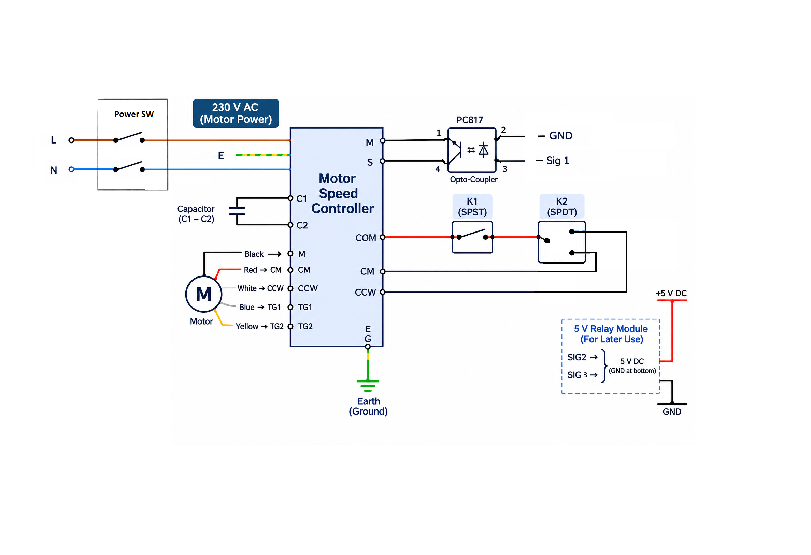

# Engineering Work Log – 19 November 2026

## 1. Work Overview

Today's work focused on developing a new 220 V AC conveyor belt system and designing a protective enclosure for the electronic components used in the conveyor control system.

## 2. Activities Performed

### 2.1 New 220 V AC Conveyor Belt

- Worked on the new 220 V AC conveyor belt system.
- Examined the conveyor motor and its electrical connections.
- Investigated the motor speed-control interface and available control-signal connections.
- Considered how the conveyor motor could be integrated with the existing automation and control system.
- Reviewed the electrical and mechanical requirements for operating the conveyor belt.

<table>
  <tr>
    <td>
      
    </td>
    <td>
      
    </td>
  </tr>
  <tr>
    <td>
      
    </td>
    <td>
      
    </td>
  </tr>
</table>

### 2.2 Electronic Components Enclosure Design

- Started designing a protective casing for the electronic components.
- Considered the space required for mounting electronic modules and control components.
- Evaluated component placement, cable routing, and accessibility for maintenance.
- Considered ventilation and heat-dissipation requirements.
- Worked towards a compact, practical enclosure suitable for integration with the conveyor system.

## 3. Progress and Outcomes

- Progressed with the development of the new 220 V AC conveyor belt.
- Started the enclosure design for the electronic control components.
- Identified electrical, mechanical, and installation considerations for system integration.

## 4. Design Files

.jpg)

## 3D CAD Models

### Electronics Cover Casing
Download [electronics_cover_casing.stl](./3D_Models/CASEONVEYOR.stl)

### Electronics Cover LID
Download [electronics_cover_lid.stl](./3D_Models/LID_CONVEYOR.stl)

<table>
  <tr>
    <td>
    Electronics Cover LID
      
    </td>
    <td>
    Electronics Cover Casing
      
    </td>

  </tr>
</table>

## 5. Next Steps

- Continue investigating and testing the conveyor motor speed-control system.
- Finalise the electronic enclosure dimensions and component layout.
- Review cable-entry points, ventilation, and mounting arrangements.
- Check the enclosure design against the actual dimensions of the electronic components.
- Plan the electrical wiring and integration of the conveyor with the automation control system.

## 6. Notes and Safety

The work is part of the ongoing development of the conveyor-based automation system. Further testing and design refinements will be carried out during the next development sessions.

**Electrical safety:** The conveyor motor operates from 220 V AC. Electrical inspection, wiring, and testing must be carried out with appropriate isolation and protection by a suitably qualified person. Do not work on live circuits.

# Engineering Work Log – 20 November 2026

## 1. Work Overview

Today's work focused on studying the existing conveyor motor control circuit board, identifying its electrical connections, and re-engineering the complete wiring arrangement. The main objective was to separate the high-voltage (230 V AC) power section from the low-voltage control-signal section, allowing the motor control system to be operated through an isolated 5 V control interface.

## 2. Activities Performed

### 2.1 Circuit Board Analysis and Connection Identification

- Studied the existing motor control circuit board and investigated its electrical architecture.
- Identified the existing wiring connections and signal paths.
- Analysed the relationship between the 230 V AC power section and the low-voltage control interface.
- Identified the required connections for motor speed, ON/OFF operation, and rotational direction control.
- Prepared an updated connection arrangement based on the identified circuit functionality.

### 2.2 Re-engineering of the Electrical Wiring

- Re-engineered the complete wiring arrangement of the motor control system.

<table>
  <tr>
    <td>
      
    </td>
    <td>
      
    </td>
  </tr>
  <tr>
    <td>
      
    </td>
    <td>
      
    </td>
  </tr>
    <tr>
    <td>
      
    </td>
    <td>
      
    </td>
  </tr>
</table>

- Separated the high-voltage (HOT) power section from the low-voltage signal-control section.
- Implemented an isolated control interface to prevent direct exposure of the external control system to the 230 V AC mains supply.
- Redesigned the control wiring so that the system can be operated using a 5 V low-voltage control interface. Design a separate cabe for micrcontroller input. 

.jpg)

- Organised the signal connections for independent motor speed, ON/OFF, and direction control.

### 2.3 Motor Control Signal Configuration

The motor controller was configured with three independent control signals:

| Signal | Function | Description |
|---|---|---|
| Signal 1 | Speed Control | Motor speed is controlled by varying the input voltage between Signal 1 and GND. |
| Signal 2 | Motor ON/OFF | Controls the motor's operating state, allowing it to be switched ON and OFF. |
| Signal 3 | Direction Control | Controls the rotational direction of the motor. |

- Verified the speed-control functionality using the Signal 1 voltage input.
- Tested the motor ON/OFF functionality through Signal 2.
- Tested rotational direction control through Signal 3.
- Confirmed that the three control functions operate independently through the low-voltage interface.

## 3. Progress and Outcomes

- Successfully analysed the existing circuit board and identified its connection arrangement.
- Completed the re-engineering of the motor control wiring.
- Separated the high-voltage power section from the low-voltage control-signal section.
- Established a 5 V low-voltage control interface with electrical isolation from the 230 V AC mains section.
- Successfully tested the re-engineered system.
- Confirmed that the motor operates without any observed errors during testing.
- Verified that motor speed, ON/OFF operation, and rotational direction can all be controlled through the corresponding input signals.

**Final outcome:** The conveyor motor can now be controlled through an isolated low-voltage interface without requiring the external control system to be directly connected to the 230 V AC mains section.

## 4. Design Files

The updated electrical wiring and circuit design documentation includes the re-engineered motor control connections and the low-voltage signal interface.

## 5. Next Steps

- Continue testing the motor controller under different speed settings.
- Verify the stability of the speed-control input across its operating voltage range.
- Test direction changes under appropriate operating conditions.
- Integrate the low-voltage control interface with the main automation control system.
- Finalise the circuit documentation and wiring diagrams.
- Complete the protective enclosure and cable-management arrangements.
- Perform further electrical isolation and safety verification before continuous operation.

## 6. Notes and Safety

The conveyor motor operates using a 230 V AC mains supply. The re-engineered control arrangement separates the high-voltage power section from the low-voltage signal interface, allowing external control using 5 V signals.

# Engineering Work Log – 23 November 2026

## Work Completed:

- Installed the 3D-printed casing to isolate and protect the 230V AC high-voltage section from the 5V low-voltage control side.

<table>
  <tr>
    <td>
      
    </td>
    <td>
      
    </td>
    <td>
      
    </td>
    <td>
      
    </td>
  </tr>
</table>

- Tested the system using the isolated 5V low-voltage control interface to verify its operation and safety.

- Successfully tested the start/stop functionality, motor direction control, and speed control signal. All functions are operating as expected.

.jpg)

- Positioned the Dobot Nova 2 robot and started the initial setup and testing of the Waveshare camera.

.jpg)

- Verified the camera connection and started working on the design of a custom 3D-printed casing to securely mount and protect the Waveshare camera.

.JPG)

[The product link](https://www.waveshare.com/gc2093-2mp-usb-camera-a.htm?srsltid=AYCX9vIXw24FVpljRkAGATEv_CESMYnRebwbYI9WELOETXZGsts0nAWU)

Outcome:

The motor control system is now successfully enclosed with the 3D-printed isolation casing, and all control functions have been tested successfully through the 5V low-voltage side. The Dobot Nova 2 setup has also been initiated, and the Waveshare camera integration and custom camera enclosure design are in progress.